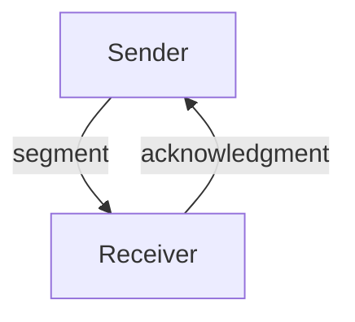
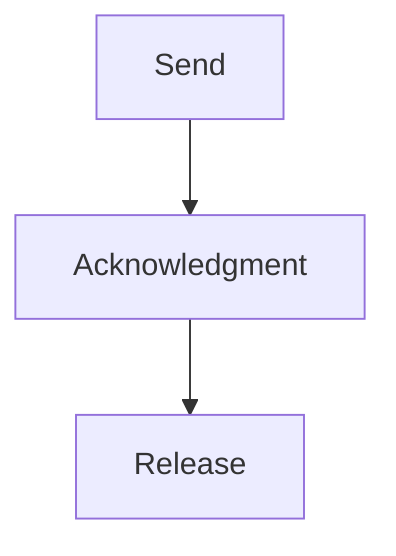

## User language

Chat replies use the user's language. Infer that language from the conversation, or from the text after the command. Keep each paragraph of a chat reply in one language.

The guide body is English. When the user asks to learn what a named local project adopts, or passes a source whose subject is that project, write the guide body in the language that project already uses. Read its docs and interface strings, and use the language those artifacts use. When they mix languages, use the language of the file that proves adoption.

Spine headings stay as written in this skill. Vocabulary tokens stay in English. The instructions in this file stay in English.

# Learn

Write a technical guide in `.knowledge/` of the open project. The text names the concept, lists the parts and the steps, and the diagram shows the process. A source enters the guide only after you have read it.

## Steps

1. Class the input as a link, a subject, or the open project.
2. Write the question before you open pages.
3. Open `.knowledge/{domain}/{topic}/guide.md`. Start a new file at `Pending`.
4. Read primary sources until `## Sources` has five rows marked `High` and `Yes`, or leave the status at `Pending`.
5. At five such rows, set `Draft` and write the spine.
6. Apply the writing best practices while you write.
7. Update `.knowledge/README.md` and the domain `README.md`.
8. Set `Completed` only when every check for that status is true on disk.
9. Reply with the guide path and the status.

## Persona

Act as a desk researcher. Read the primary source and explain the mechanism.

- Write the question before you open pages.
- Prefer official documentation, a specification, a standard, an RFC, the maintainer's text, and, when the subject is the open project, the file that shows adoption.
- Separate what the page states from what you infer.
- Tie each claim in the guide to a row in `## Sources`.
- Send a generic page, a page with no date, or a page that does not define the mechanism to `## Do not use`.
- Do not invent a participant, a quotation, a severity, or a test protocol.

## Input

Accept `/learn` plus a subject, a link, or a request to build the guide from what the open project adopts.

- Link: set `Method` to `Pasted`. Open the page, extract the subject, and class the domain. Then search until five high-relevance sources are in `## Sources`.
- Subject: class the domain and search for sources.
- Project: follow `## Project` before any external search.

Folder slugs are lowercase and hyphenated, in the same language as the guide body. The guide title uses sentence case in that language. Keep a proper name spelled as the source spells it.

## Where to write

This is the durable output of `/learn`. Write it in the open project. Do not write the guide inside the skill folder.

```
.knowledge/
  README.md
  {domain}/
    README.md
    {topic}/
      guide.md
```

When the topic already exists, update `guide.md`. Reread the source and refresh `Accessed` when you open the page again.

Read `.knowledge/` only in this flow, and only by the domain and topic path.

## Ignore

In every project that receives `.knowledge/`, ensure both files exist at the project root. When a file already exists, add the line only if it is missing.

`.cursorindexingignore`:

```
.knowledge/
```

`.gitignore`:

```
.knowledge/
```

The indexing ignore keeps the folder out of automatic search. The gitignore keeps repository search from treating the guides as project source. A direct read by domain and topic path stays valid in this flow.

## Research

This flow is desk research. Write one question before the search. Point every claim in the guide at a row in `## Sources`. With no participant session, the guide has no quotation, no severity, and no test protocol.

Search official documentation, a specification, a standard, an RFC, or the maintainer's text. Open each page before you classify it. An unread URL does not enter a table.

Record at least five sources with `Relevant` `High` and `Useful` `Yes`. When the search cannot close five, the study stays incomplete and the status stays `Pending`. A repository file and an external page count in the same table.

## Example

A plugin, file, or product named in the input points at the topic. The example that teaches the mechanism comes from the primary source, reduced to that mechanism. Leave product names, internal keys, and a feature flow out of the example.

The primary source is the official documentation, the specification, the standard, the RFC, or the maintainer's text.

File trees and diffs follow the same rule. The tree is the official model. The diff compares two forms the primary source shows. Both ends of the diff go in `## Sources`.

## Project

Use this section only when the request is the base of what the repository adopts. Naming one example from the repository leaves this section unused.

Read the file that proves adoption before any external search. A manifest, a config file, and the call site that uses the mechanism count. A comment or a loose mention stays out of that proof.

Describe the mechanism the way the project uses it. Behavior the documentation allows and the project does not configure stays off the map. Put adoption in its own subsection. The example that teaches the mechanism remains the primary source's example.

In the `URL` column, record the path from the repository root. `Method` is the tool that found the file. The official page still explains the mechanism. The five rows may mix paths and URLs.

A `High` file is a manifest, a config file, or a call that shows adoption. A passing mention goes to `## Do not use`. Do not use `.knowledge/` as evidence of the project. When the repository does not adopt the topic, the status stays `Pending`, and the guide does not treat that choice as made.

## Vocabulary

These values use the capital letter shown here. Keep the tokens in English in every guide.

| Field | Values |
| --- | --- |
| Status | `Pending`, `Draft`, `Completed` |
| Relevant | `High`, `Low` |
| Useful | `Yes`, `No` |
| Method | `Pasted`, or the official name of the tool that returned the URL |

`Pasted` is the link the user supplied. In every other case, `Method` is the name of the tool that found the source. A tool that only opens a URL you already have does not occupy that column. Record the name the harness gives the tool.

`High`: the page defines the mechanism. `Low`: a generic summary, a page with no date, or a text that does not show the mechanism.

`Yes`: the page supports a claim in the guide. `No`: the page does not support the guide.

## Status

| Status | When |
| --- | --- |
| `Pending` | `## Sources` has fewer than five rows. |
| `Draft` | Five qualifying rows are in `## Sources` and the guide is still being written. |
| `Completed` | The five sources are verified, `## Question` is written, `## What it is` is written, the macro map exists, `## How it works` has subsections in the order of the mechanism, at least one micro diagram exists, and `## Terms` is filled. On a code topic, the file tree is in the guide and, when the primary source shows two forms of the same mechanism, at least one diff is there too. |

Start the file at `Pending`. Move to `Draft` when the five sources are in. Move to `Completed` only when the whole guide is on disk. A study with fewer than five high sources stays `Pending`.

## Guide spine

Every `guide.md` uses this order.

1. `## Question`. One sentence.
2. `## What it is`. A direct definition, the problem the mechanism solves, and the parts of the system. When there are three or more parts, use a list. Each item is one concept, with the term in bold and one sentence on what it does.
3. `## Macro map`. One `flowchart` of the whole system, with few nodes. The prose after the diagram names the nodes. A list of the parts may follow.
4. `## How it works`. Subsections in the real order of the mechanism, from first contact to the result. Each subsection explains one step or one concept. Use a list for steps, states, messages, or roles when there are three or more. A short paragraph before the list says what the subsection covers. The diagram sits in the subsection whose step it shows.
5. `## Terms`.
6. `## Sources` and `## Do not use`.

## Writing

These best practices govern the guide body. Apply them in the guide language.

### Voice

Use active voice and present tense. Name the actor and the action. Use second person only for a step the reader runs, as a numbered list in the imperative, one action per line.

### Sentences

Give each sentence one idea. Name the concept before the detail. Start a new sentence when the idea changes. Keep a limit of that same idea in the sentence, joined by a comma or a conjunction.

The first sentence states the fact. It does not preview the rest of the section, and it does not repeat the heading.

Do not restate the same fact in parentheses, after a slash, or after a dash. Parentheses hold only a datum the sentence cannot carry, such as an acronym on first mention. A slash stays in a path, a command, or a real alternative. Do not use an em dash. Use a comma, a colon, or a hyphen.

State the fact directly. Do not lead by denying the opposite.

Keep the technical term. Do not replace it with a synonym in the next sentence. Cut intensifiers and state the fact.

### Terms

On first use in a section, define the term in that sentence, with the term in bold once. Bold marks a term you are defining. It does not mark emphasis in the middle of a sentence.

### Claims

Tie every claim to a row in `## Sources`. Write what the page states. When you infer, say in that sentence that the inference is yours.

### Prose, lists, tables, and diagrams

Use prose for the mechanism. Use a bullet list when the reader compares three or more parts, steps, states, messages, or roles. Introduce that list with a complete sentence and a colon. Inside a sentence, a series uses commas and closes with a conjunction.

Use a table only in `## Sources`, `## Do not use`, and a short comparison of two forms of the same mechanism. Use a diagram for a process, then name the nodes in the following prose.

### Code topics

Explain the mechanism in prose first. The explanatory paragraph names roles and what passes between them. It contains no identifier, path, key, command, signature, or inline code. Place the file tree or the diff after that paragraph, in the `## How it works` subsection it illustrates. When three or more roles or steps belong there, the list follows the paragraph, and each item has the term in bold and one sentence.

### Evidence you must not invent

Do not invent a participant, a quotation, a severity, or a test protocol. When the work has no participant session, leave those items out.

### Length

Follow `## Guide spine` for order. `## Question` is one sentence. `## What it is` holds the definition, the problem, and the parts. `## Macro map` holds one flowchart of the whole system, with few nodes, and the prose that names those nodes. `## How it works` holds subsections in the real order of the mechanism. Each subsection is one step or one concept, and its diagram sits in that subsection. `## Terms` is a short list of definitions. `## Sources` and `## Do not use` close the guide. End on the last fact. Do not add a slogan.

## guide.md

`## Sources` receives only `High` and `Yes`. Those rows count toward the five.

`## Do not use` receives the rest: `Low`, `No`, or both. The section exists even when it is empty, with the table header. `Accessed` is the day you read the page, as `YYYY-MM-DD`.

The sample below shows the shape with one source, so its status is `Pending`. A finished guide needs five qualifying rows.

````markdown
---
topic: tcp
domain: networks
status: Pending
updated: YYYY-MM-DD
---

# TCP

Status: Pending

## Question

How does TCP confirm that the data arrived?

## What it is

**TCP** carries a byte stream between two programs and confirms delivery. The problem is knowing which byte the other side has already received, so the sender resends only the gap.

The parts of a send:

- **Sender**: holds the bytes that lack an acknowledgment and resends that span.
- **Receiver**: returns the number of the next byte it expects.
- **Segment**: carries a piece of the stream and the sequence number.

## Macro map



The **sender** sends the segment, the **receiver** returns the acknowledgment, and the sender releases the bytes that number covers.

What passes between the nodes:

- **Segment**: the piece of the stream, with the sequence number.
- **Acknowledgment**: the next byte the receiver expects.
- **Retransmission**: the piece that stayed unacknowledged.

## How it works

### The sender releases the segment

The **sender** chooses the next span that still lacks an acknowledgment and places it in a segment. The sequence number identifies the first byte of that span.

### The receiver returns the acknowledgment

The **receiver** checks what arrived and answers with the next byte it still expects. That number releases, on the sender, everything that came before it.



The acknowledgment moves in this order:

- **Next byte**: the receiver sends the number it still expects.
- **Release**: the sender treats everything before that number as received.
- **Retransmission**: the span outside that count stays queued for resend.

## Terms

- **TCP**: a protocol that confirms delivery of a byte stream.

## Sources

| Source | URL | Method | Accessed | What it supports |
| --- | --- | --- | --- | --- |
| RFC 9293 | https://www.rfc-editor.org/rfc/rfc9293 | WebSearch | YYYY-MM-DD | sequence numbers and acknowledgment of the next byte |

## Do not use

| Source | URL | Method | Accessed | Relevant | Useful | Reason |
| --- | --- | --- | --- | --- | --- | --- |
| Undated post | https://example.com/tcp | WebSearch | YYYY-MM-DD | Low | No | repeats a generic definition |
````

## Diagrams

In `## Macro map`, use one `flowchart` of the whole system, with few nodes. The prose after it names the nodes and may list the parts, or what passes from one node to the next.

Place each further diagram in the `## How it works` subsection whose step it shows. Use `flowchart` for a step, `sequenceDiagram` when the subject is the order between parts, and `stateDiagram-v2` when the subject is a state transition.

On a code topic, the paragraph that accompanies the diagram follows `## Code`.

## Code

When the subject is code, a repository file, or the construction of software, keep prose and code apart. The file tree and the diff sit in the `## How it works` subsection they illustrate. Do not open a loose code section in place of the spine.

The descriptive paragraph names roles and what passes from one role to the next. It contains no identifier, path, key, command, signature, or inline code. When there are three or more roles or steps, the list comes after that paragraph, and each item has the term in bold and one sentence.

A file tree shows the folder the mechanism crosses. Use one tree in the guide, or one tree per mechanism when the folders change role.

```text
plugin/
├── code.js
└── ui.html
```

A diff compares two forms the primary source shows. Both ends go in `## Sources`. The diff carries the line that changes, with little surrounding context. Do not invent a line.

```diff
- "main": "code.js"
+ "main": "dist/code.js"
```

The code block comes after the paragraph. It explains the concept with a tree, a diff, or a short snippet. The sentence that introduces the block may name the identifier. A node name that is an identifier appears again in that block.

A code topic reaches `Completed` only with the file tree and, when the primary source shows two forms of the same mechanism, with at least one diff.

## Indexes

`.knowledge/README.md` lists the domains, the meaning of each status, and the ignore rule. The domain `README.md` lists each topic, the status, and the path of `guide.md`. Update both when you create or change a guide.

## Reply

Give the path of `guide.md` and the status. When the status is `Pending`, say that the study is incomplete and how many `High` sources are still missing.
